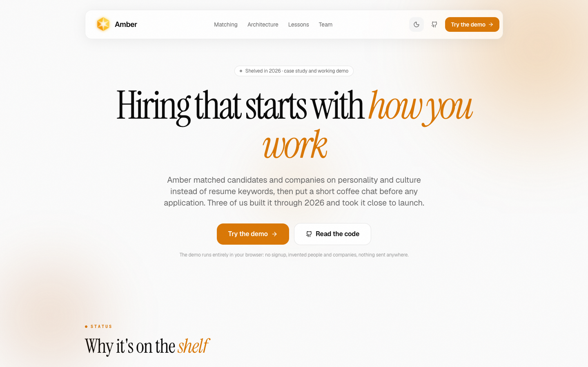
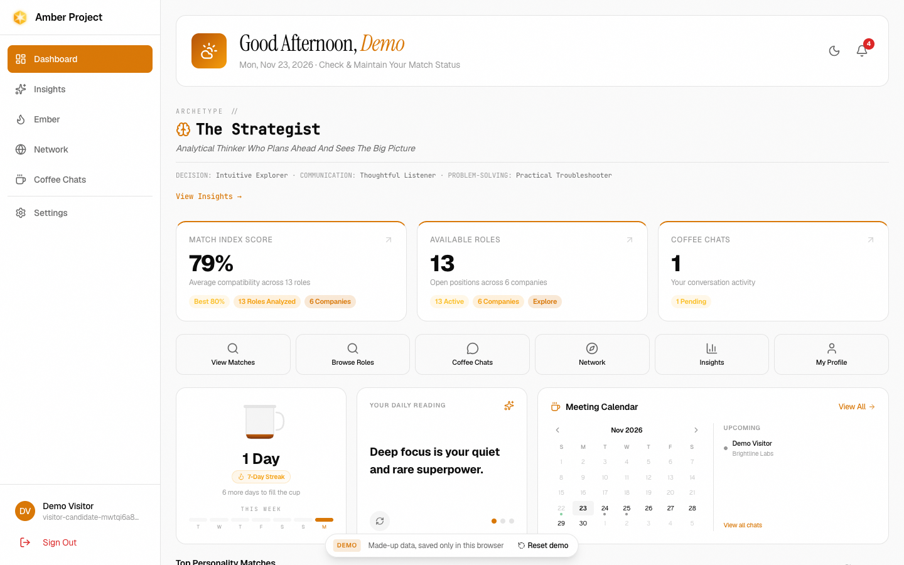
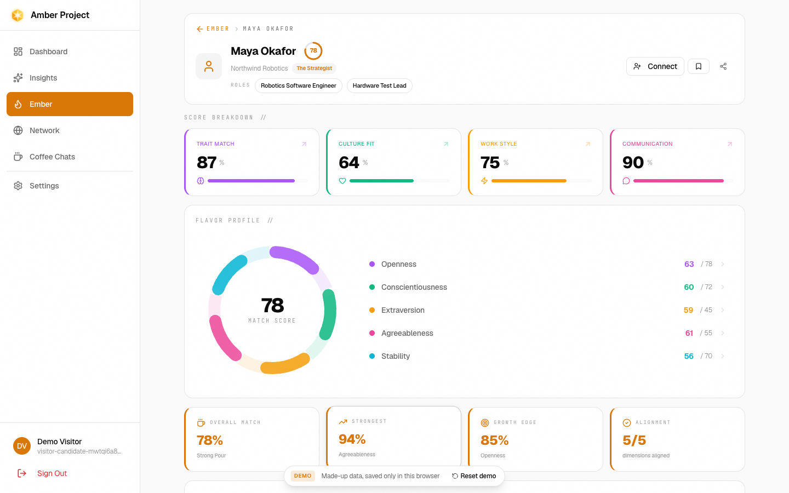
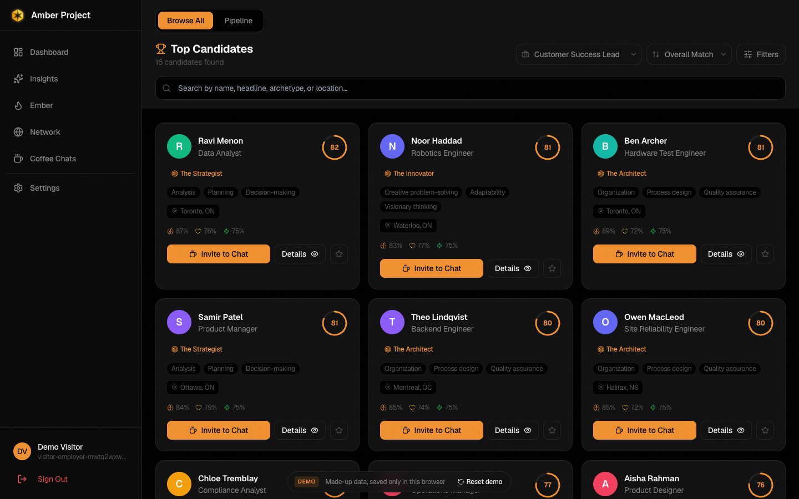
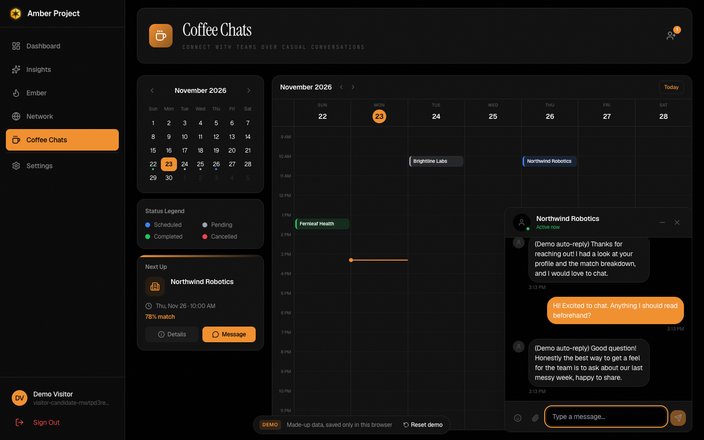
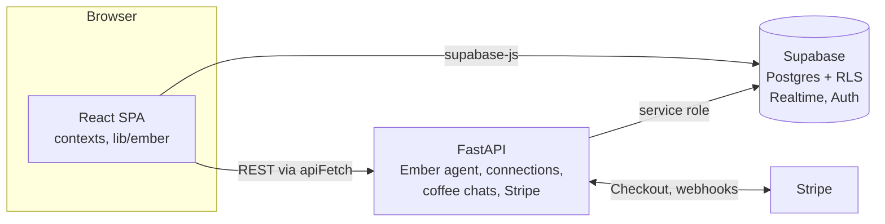

# Amber - Culture-First Job Matching

**[Try the demo](https://nakulpatel0306.github.io/amber/)**: it runs entirely in your browser, with invented people and companies and no signup.

Amber matched candidates and companies on personality and culture fit instead of resume keywords. Candidates took a Big Five (OCEAN) assessment and got one of 8 work archetypes, employers defined their culture and per-role trait ranges, and the Ember engine ranked both sides against each other. Matches met over a short coffee chat before any application.

**Status:** shelved in 2026. Three of us built Amber from January to November 2026 and took it close to launch. The culture-fit hiring space filled up quickly, competing would have meant raising money, and we chose not to. The code stays open and the full stack still runs locally.



## At a Glance

- **Stack:** React 19, TypeScript, Vite 7, Tailwind CSS, Framer Motion; Python 3.11, FastAPI; Supabase (Postgres, Row Level Security, Realtime, Auth); Stripe
- **Context:** Team project with three contributors (see [Team](#team))
- **State:** Archived. Not in development, kept runnable as a case study with a browser-only demo

## Features

- **Assessment and archetypes.** Scenario, trade-off, ranking and slider questions map to the five OCEAN traits, then to one of 8 archetypes (Innovator, Architect, Connector, Catalyst, Craftsperson, Harmonizer, Explorer, Strategist)
- **Employer culture.** A culture quiz sets the trait scores a company hopes for and its culture values; each role gets an acceptable range per trait and a work style
- **Ember matching.** Ranked matches on both sides with a per-trait breakdown, an archetype-pair bonus, and written strengths, cautions and tips for every pairing
- **Coffee chats before applications.** Connection requests carry proposed times; accepted chats get scheduling, realtime messaging, a personality-based prep brief and post-chat feedback
- **Network hub.** People, companies, roles and a hobby-photo feed so candidates show more than a resume
- **Billing.** Two paid tiers per side as Stripe subscriptions, with Checkout, Customer Portal and webhooks
- **Demo mode.** One build flag swaps Supabase and the FastAPI client for an in-browser stand-in, so the real components run against seeded fictional data on GitHub Pages

| Job seeker dashboard | Ember deep dive |
|---|---|
|  |  |
| **Employer: candidates ranked for a role** | **Coffee chat with an automatic demo reply** |
|  |  |

## How Matching Works

Everything lives in [`src/backend/engine/compatibility.py`](src/backend/engine/compatibility.py) and [`src/backend/agent/ember_agent.py`](src/backend/agent/ember_agent.py). Every score is 0 to 100.

| Part | Weight | How it's computed |
|---|---|---|
| Trait distance | 40% | Euclidean distance between candidate scores and the employer's preferred scores across all five traits, scaled so identical profiles score 100 |
| Culture and role fit | 30% | Work style (30%), culture values mapped onto traits (50%, e.g. *innovation* leans on openness, *balance* on low neuroticism) and how many traits sit inside the role's ranges (20%) |
| Work style | 20% | Remote, hybrid, onsite or flexible, from a small compatibility table |
| Communication | 10% | Closeness on extraversion (55%) and agreeableness (45%) |

The Ember score then adds an archetype-pair bonus from an 8 by 8 table (`agent/archetype_compatibility.py`), between -10 and +10, clamped to 0 to 100. Because it's plain arithmetic, the UI can show exactly why two people match.

The frontend scores matches client-side for instant UI, so [`src/frontend/src/lib/ember/`](src/frontend/src/lib/ember/) is a line-for-line TypeScript port, including Python's round-half-to-even. [`tests/fixtures/ember-parity.json`](tests/fixtures/ember-parity.json) holds 120 generated cases, 200 archetype checks and 6 full rankings; pytest checks the Python engine against it and vitest checks the TypeScript port, so neither side can drift without failing CI. Regenerate it with `src/backend/scripts/generate_parity_fixture.py` after an intentional scoring change.

## Architecture



The app reads and writes Postgres directly through supabase-js; Row Level Security decides who sees which rows and Realtime pushes messages, requests and chat updates. FastAPI handles what a browser shouldn't: the Ember agent, the side effects of accepting a connection, prep briefs and Stripe. More detail in [docs/ARCHITECTURE.md](docs/ARCHITECTURE.md).

### Demo mode

The GitHub Pages build (`npm run build:demo`, which sets `VITE_DEMO=1` and base `/amber/`) changes exactly two modules:

- [`lib/supabase.ts`](src/frontend/src/lib/supabase.ts) returns [`src/demo/client.ts`](src/frontend/src/demo/client.ts) instead of a supabase-js client: the query builder the app uses (selects with embedded relations, filters, ordering, single rows, counts, insert, update, upsert, delete), RLS-style row visibility, auth, realtime channels and storage, over tables kept in `localStorage`
- [`utils/api.ts`](src/frontend/src/utils/api.ts) routes `apiFetch` to [`src/demo/backend.ts`](src/frontend/src/demo/backend.ts), which serves the same routes and response shapes as FastAPI using the TypeScript Ember port

Everything else is the production code. Seeded people (16 candidates, 6 companies, 13 roles, all invented, all `example.com`) accept requests and answer messages on their own, and those replies are labelled as automatic. A banner offers "Reset demo" at any time. The demo makes no network requests beyond the site's own files, and the normal build tree-shakes the demo out.

## What We Learned

- **Explainable math beat a black box.** Weighted distance plus a culture table was easy to trust, easy to debug and easy to talk about in a coffee chat.
- **Client-side Supabase was fast to build on; RLS was the cost.** Authorization lived in policies, and policies that referenced each other recursed. The `supabase/fix-*-recursion.sql` scripts are what that taught us.
- **Two implementations need one test.** The Python and TypeScript engines had drifted. The parity fixture caught a real mismatch the first time it ran.
- **Two-sided products start cold twice.** Candidates want companies before investing fifteen minutes, and companies want candidates before defining a culture. The coffee-chat-first flow was the part people liked most, and the part that needs both sides present.

## Project Structure

```
.
├── src/
│   ├── frontend/                 # React app (npm workspace)
│   │   └── src/
│   │       ├── components/       # UI by area: landing, auth, dashboard, ember, coffee-chats, ...
│   │       ├── contexts/         # Auth, theme, toast, messaging, connections
│   │       ├── demo/             # In-browser Supabase and FastAPI stand-ins, seed data, demo UI
│   │       ├── lib/ember/        # TypeScript port of the scoring engine and Ember agent
│   │       ├── lib/              # Supabase client, personality engine, archetypes, Stripe
│   │       └── hooks/, types/, utils/, data/, styles/
│   └── backend/                  # FastAPI server
│       ├── main.py               # App entry point and routes
│       ├── engine/               # OCEAN scoring and compatibility (source of truth)
│       ├── agent/                # Ember agent and archetype-pair matrix
│       ├── auth/, db/            # Supabase JWT checks, data access
│       ├── scripts/              # Seeds and the parity fixture generator
│       └── tests/                # pytest: engine, agent, parity
├── supabase/                     # Schema, RLS policies, migrations, seeds
├── tests/fixtures/               # Shared parity fixture for pytest and vitest
├── docs/                         # Architecture notes and screenshots
└── .github/workflows/            # CI (test.yml) and GitHub Pages deploy (pages.yml)
```

## Running Locally

### Demo mode (no setup)

Needs Node 18+.

```bash
git clone https://github.com/nakulpatel0306/amber.git
cd amber
npm install
npm run dev:demo --workspace src/frontend    # http://localhost:5173/amber/
```

### Full stack

Needs Node 18+, Python 3.11+ and a Supabase project.

1. **Database:** in the Supabase SQL editor, run `supabase/schema.sql`, then `supabase/rls-policies.sql`, then the migrations. Enable Email, Google and GitHub auth. Full steps are in [supabase/README.md](supabase/README.md).
2. **Env files:** copy `src/backend/.env.example` to `src/backend/.env`, and create `src/frontend/.env`. Fill in:
   - Frontend: `VITE_SUPABASE_URL`, `VITE_SUPABASE_ANON_KEY`; optionally `VITE_API_URL` (defaults to `http://localhost:8000`) and the `VITE_STRIPE_PRICE_*` plan IDs
   - Backend: `SUPABASE_URL`, `SUPABASE_ANON_KEY`, `SUPABASE_SERVICE_ROLE_KEY`, `SUPABASE_JWT_SECRET`
   - Backend, optional: `STRIPE_SECRET_KEY`, `STRIPE_WEBHOOK_SECRET`, `LOGO_DEV_API_KEY` (company logos), `FRONTEND_URL`
3. **Backend:**
   ```bash
   cd src/backend
   python3 -m venv venv && source venv/bin/activate   # Windows: venv\Scripts\activate
   pip install -r requirements.txt
   ```
4. **Run both:** from the project root:
   ```bash
   npm install
   npm run dev
   ```
   The app runs at `http://localhost:5173` and the API at `http://127.0.0.1:8000`, with interactive API docs at `/docs`.

If `SUPABASE_JWT_SECRET` is not set, the API runs in dev mode and skips auth on protected routes.

## Tests

| Command | What it runs |
|---|---|
| `npm test` | Frontend vitest (scoring, archetypes, parity, demo adapter) and backend pytest (engine, agent, parity) |
| `npm run lint` | ESLint on the frontend, `ruff` on the backend |
| `npm run typecheck --workspace src/frontend` | `tsc --noEmit` |
| `npm run build --workspace src/frontend` | Full-stack build into `src/frontend/dist` |
| `npm run build:demo --workspace src/frontend` | GitHub Pages demo build |

The backend commands use `src/backend/venv` from step 3; the engine tests only need `pytest`. CI runs all of the above on every push and pull request, and `pages.yml` deploys the demo from `main`.

## Team

- [Nakul Patel](https://github.com/nakulpatel0306)
- [Arsh Patel](https://github.com/Arshpatel10)
- [Neel](https://github.com/neelp04)

## License

MIT, see [LICENSE](LICENSE).
